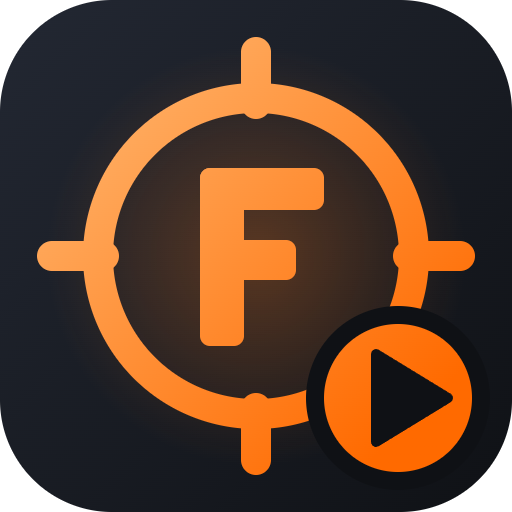

<h1 align="center">FragLab Demo Reviewer</h1>

Review your CS2 demos like a coach: stats, coaching findings, a 2D replay of every round, and heatmaps for each player. Part of the <b>FragLab</b> family.

<a href="https://github.com/M0RTENS3N/fraglab-demo-reviewer/releases/latest"><b>⬇ Download the latest version</b></a>

---

## What it does

- **Your dashboard:** your last match, your rating per match, rating/ADR/KAST/HS/win-rate trends, and the problems that keep coming back.
- **Coaching findings** for you and your team, with the rounds to rewatch. Examples:
  - "Died 7 times holding utility ($4,000 wasted)"
  - "79% of your deaths were not traded"
  - "Lost 2 rounds while 2+ players up"
- **Full report:** scoreboard (K/D/A, ADR, KAST, HS%, rating), opening duels, trades, clutches, utility, economy, and a round-by-round kill feed with CS2's own icons.
- **2D replay:** every round on the map radar, with positions, view directions, HP, weapons, grenades, smokes, fires and the bomb.
- **Heatmaps** for any player or the whole team:
  - where they spend their time, where they get kills and die, and where their utility lands;
  - filter by side and by part of the round.
- **Optional AI coach review:** with [Ollama](https://ollama.com) (free, runs on your PC) or Claude (your own API key).

## Install

1. Download `FragLab-DemoReviewer-Setup-x.y.z.exe` from the [latest release](https://github.com/M0RTENS3N/fraglab-demo-reviewer/releases/latest).
2. Run it. It needs no admin rights and no .NET. It asks for your in-game name and installs to your user folder.
3. Open **FragLab Demo Reviewer** from the Start Menu. Your demos from CS2's folder show up automatically, so pick one and click **Review**.

Updates appear in the app as a banner: **Update & restart**.

**Requirements:** Windows 10 or 11 (64-bit). CS2 installed on the same PC; the map radars and kill-feed icons are read from your own CS2 install.

## Privacy

Everything runs on your PC. Demos and reports never leave it. The only exception is when you choose the Claude AI review, which sends the computed stats (not the demo) to Anthropic's API with your own key.

---

Not affiliated with Valve. Counter-Strike 2 is a trademark of Valve Corporation.
